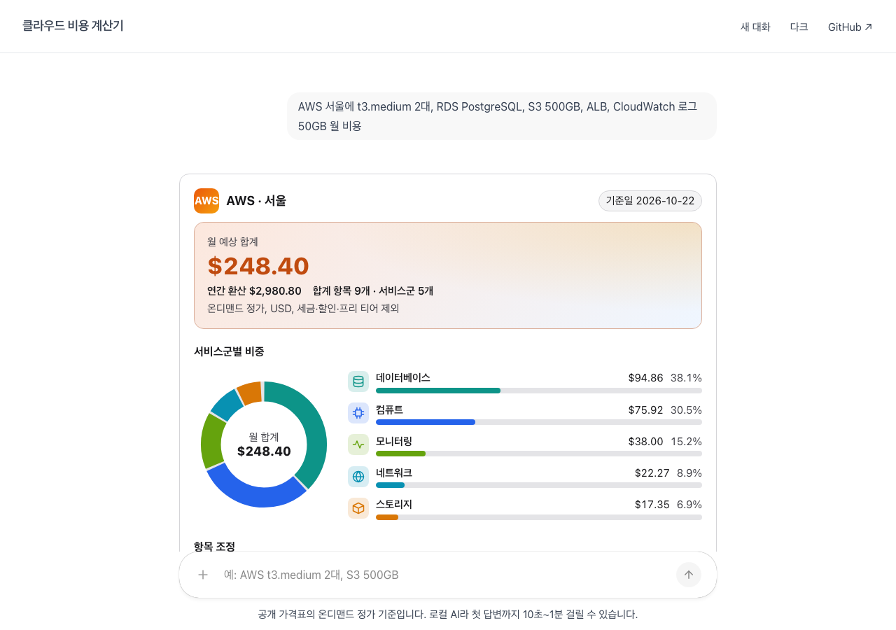
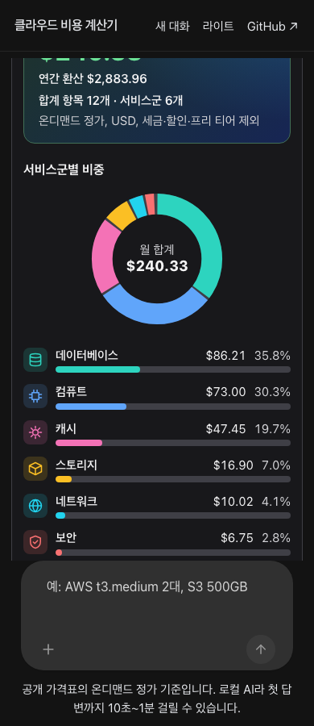

# 클라우드 비용 계산기

AWS, Azure, GCP 구성을 한국어 문장으로 설명하면 **공개 가격표**로 월 비용을 계산해 표·막대·계산기 화면으로 보여 줍니다.

- **LLM은 로컬만**: 이 컴퓨터의 [Ollama](https://ollama.com)(`qwen3.5:latest`)만 씁니다. 외부 LLM API를 호출하지 않습니다.
- **가격은 지어내지 않음**: LLM은 문장을 "서비스 + 사양 + 수량"으로 바꾸기만 합니다. 단가는 공개 가격 API로 만든 가격표에서, 계산은 코드가 합니다.
- **같은 입력이면 같은 합계**: 사양 대안(예: RDS PostgreSQL/MySQL, 인스턴스 크기)은 선택 상자로 두고 합계에는 하나만 넣습니다.

| 데스크톱(라이트) | 모바일 390px(다크) |
|---|---|
|  |  |

## 어떻게 동작하나

```
브라우저 ─▶ gate(nginx, :8095) ─▶ app(Next.js + CopilotKit) ─▶ agent(FastAPI + LangGraph)
                                                                 ├─ ChatOllama ─▶ 호스트 Ollama :11434
                                                                 └─ estimate_cost ─▶ 가격표(JSON)
```

1. 모델은 질문을 `estimate_cost(cloud, items=[{service, spec, count, gb, million}], region)` 호출로 바꿉니다. 모델이 보는 도구는 이것 하나뿐입니다.
2. 계산 엔진(`apps/agent/pricing/engine.py`)이 서비스의 가격표 항목을 모두 줄로 만듭니다. 대안 묶음은 가장 싼 것(또는 사용자가 말한 사양) 하나만 합계에 넣습니다.
3. 화면은 결과 JSON을 고정 부품(`apps/app/src/components/cost/`)으로 그립니다. 합계 카드(연간 환산 포함), 서비스군 비중 도넛 차트와 범례, 서비스군 아이콘과 색, 항목별 비중 막대·슬라이더·산식, 대안 선택 상자, 기준일이 들어갑니다. 차트는 외부 라이브러리 없이 SVG로 그립니다. 슬라이더를 움직이면 브라우저에서 BigInt 센트로 다시 계산합니다.

### 계산 규칙

- 월 비용 = 단가 × quantity_scale × 월 시간(730) × 수량. 센트 단위로 반올림(0.5는 올림)합니다.
- 수량을 말하지 않으면 최소 구성 기본값을 쓰고 화면에 "가정"으로 표시합니다. 기본값은 개수 1, 백만 단위 1, GB 100입니다.
- 온디맨드 정가(USD)만 씁니다. 세금, 약정 할인, 프리 티어는 빼고, 가격표에 없는 서비스나 사양은 합계에서 빼고 표시합니다.

### 가격표

| 클라우드 | 출처 | 기준일 | 항목 × 리전 |
|---|---|---|---|
| AWS | [Price List Query API](https://docs.aws.amazon.com/aws-cost-management/latest/APIReference/API_pricing_GetProducts.html) | 2026-10-22 | 46 × 3 (서울, 도쿄, 버지니아) |
| Azure | [Retail Prices API](https://prices.azure.com/api/retail/prices) | 2026-10-23 | 31 × 3 (한국 중부, 일본 동부, 미국 동부) |
| GCP | [Cloud Billing Catalog API](https://cloud.google.com/billing/docs/reference/rest) | 2026-10-23 | 39 × 3 (서울, 도쿄, 아이오와) |

가격표는 `apps/agent/pricing/catalogs/`의 JSON이고, 화면에 기준일이 표시됩니다. 다시 만들려면 아래 `make prices`를 씁니다. AWS는 인증 없이 공개 bulk 파일로, Azure는 인증 없이, GCP는 `GCP_ACCESS_TOKEN`(`gcloud auth print-access-token`)으로 만듭니다. `.env`에 `PRICE_REFRESH=true`를 넣으면 에이전트가 매일 04:00(KST)에 AWS·Azure를 다시 만듭니다. GCP 토큰은 약 1시간이면 만료되므로 GCP는 손으로만 다시 만듭니다. 이때 빌드가 실패하거나 항목이 빠지면 이전 단가를 그대로 씁니다.

## 실행

준비물은 [Ollama](https://ollama.com)와 `ollama pull qwen3.5:latest`, Docker(또는 OrbStack)입니다.

```bash
cp .env.example .env      # TRUSTED_PROXY_IP 등 설정 (.env는 커밋하지 않음)
docker compose up -d --build
```

- 공개 포트는 `PUBLIC_PORT`(기본 8095) 하나입니다. 설정하지 않으면 gate는 루프백만 받아들입니다.
- 앞단 리버스 프록시를 쓸 때는 `.env`에 `TRUSTED_PROXY_IP`와 `PROXY_SECRET`(영문·숫자 32자 이상)을 넣습니다. 프록시는 `proxy_set_header X-Proxy-Secret <값>;`과 `proxy_set_header X-Real-IP $remote_addr;`를 보내야 합니다. gate는 비밀 헤더가 맞는 요청만 통과시키고, 그때만 `X-Real-IP`를 방문자 IP로 씁니다. 비밀값 없이 `TRUSTED_PROXY_IP`만 넣으면 gate가 시작되지 않습니다.
- OrbStack이나 Docker Desktop은 포트를 넘겨줄 때 출발지 주소를 런타임 게이트웨이(예: `192.168.171.1`)로 바꿉니다. 이 경우 `TRUSTED_PROXY_IP`에는 그 주소를 넣습니다(`docker compose logs gate`로 확인). 그러면 같은 LAN에서 포트로 바로 들어오는 요청도 같은 주소로 보이므로, 실제로 막는 것은 비밀 헤더입니다. gate 로그의 `secret=ok|absent|mismatch`로 헤더가 제대로 오는지 볼 수 있습니다(값은 기록하지 않음).
- Nginx Proxy Manager는 Advanced 칸을 `server` 블록에 넣고, 자체 `location /` 안에 `proxy_set_header`를 따로 둡니다. 그래서 Advanced 칸에 넣은 `proxy_set_header`는 무시됩니다. 대신 Advanced 칸에는 `set $cost_proxy_secret <값>;`을 넣습니다. 그리고 Custom Locations에 `~` `/` 위치(같은 전달 대상, 응답 버퍼링 끔)를 만들고, 그 고급 칸에 `proxy_set_header X-Proxy-Secret $cost_proxy_secret;`을 넣습니다. 수식어 없는 `/`는 기본 위치와 겹쳐 설정 검사가 실패합니다.
- 앞단 nginx는 응답이 스트리밍(SSE)이므로 `proxy_buffering off;`와 `proxy_read_timeout 300s;`를 권합니다.
- 첫 질문은 모델을 메모리에 올리느라 1분 이상 걸릴 수 있습니다. 에이전트가 기동할 때 미리 올리고, 30분 동안 쓰지 않으면 내려갑니다.

### 개발

```bash
make install
make dev-agent   # http://localhost:8123
make dev-app     # http://localhost:3000 (LANGGRAPH_DEPLOYMENT_URL 기본값 http://localhost:8123)
make test        # pytest + vitest
make prices      # AWS/Azure 가격표 재생성 (GCP: GCP_ACCESS_TOKEN=$(gcloud auth print-access-token) uv run python -m pricing.build_gcp)
                 # 주의: 저장소의 가격표 JSON을 덮어씁니다. 지금 든 가격표를 그대로 쓰려면 실행하지 마세요.
cd apps/agent && uv run python -m scripts.eval_extraction   # 로컬 모델의 인자 추출 정확도
```

## Open Intelligent UI 기반

이 프로젝트는 CopilotKit의 [Open Intelligent UI](https://github.com/CopilotKit/OpenIntelligentUI)(MIT, 커밋 `8391a94`)를 바탕으로 만들었습니다. 원본 라이선스는 [`LICENSE.OpenIntelligentUI`](LICENSE.OpenIntelligentUI)에 있습니다.

원본에서 바꾼 것은 다음과 같습니다.

- 답변 모델(OpenAI/Anthropic)과 표현 방식 라우터 Jev(외부 SaaS)를 로컬 Ollama 하나로 바꿨습니다.
- BYOK 키 입력 화면, 사용 통계 전송, PostHog, 외부 글꼴을 뺐습니다.
- 모델 래퍼(`CredentialScopedModel`)를 없앴습니다. 이 래퍼를 쓰면 글자가 두 번 스트리밍됩니다.
- OIUI의 도구 기반 Generative UI(`useRenderTool`) 경로로 비용 카드를 그립니다. 모델이 HTML/JS를 직접 만드는 샌드박스 생성(Open Generative UI)은 껐습니다. 9B급 로컬 모델에게는 느리고 불안정하며, 계산기는 늘 같은 모양이어야 하기 때문입니다.
- `@ag-ui/client`의 ESM 빌드가 `fast-json-patch`를 namespace import해서 Node에서 `applyPatch`가 `undefined`가 됩니다. Docker 빌드에서 기본 import로 고칩니다.

## 라이선스

[MIT](LICENSE)

### 사용한 오픈소스
- [Open Intelligent UI](https://github.com/CopilotKit/OpenIntelligentUI)(MIT): 원본 저작권 고지를 [`LICENSE.OpenIntelligentUI`](LICENSE.OpenIntelligentUI)에 그대로 두었습니다. CopilotKit 로고와 글꼴 같은 원본 자산은 쓰지 않습니다.
- 의존성: 2026-10-25에 검사했습니다.
  - JS 운영 의존성 678개는 MIT, ISC, Apache-2.0, BSD가 대부분입니다. 예외는 `@img/sharp-libvips`(LGPL-3.0, Next.js 이미지 처리용 동적 라이브러리를 수정 없이 씀)와 `caniuse-lite`(CC-BY-4.0)입니다.
  - Python 의존성 51개는 MIT, BSD, Apache-2.0이 대부분입니다. 예외는 `certifi`(MPL-2.0, 수정 없이 씀)입니다.
  - GPL·AGPL 의존성은 없습니다.
  - 패키지 정보에 라이선스 표기가 없는 것도 있습니다. JS의 `@ag-ui/langgraph`, Python의 `ag-ui-langgraph`(둘 다 MIT인 AG-UI 저장소 소속), `khroma`(MIT 파일 포함), 그리고 CopilotKit 런타임의 유료 기능 검사용 하위 패키지 `@copilotkit/license-verifier`입니다.
  - 이 저장소에는 잠금 파일만 들어 있고 의존성 파일 자체는 들어 있지 않습니다. Docker 이미지를 공개 레지스트리에 올린다면, 그 전에 위 패키지들의 고지와 조건을 함께 확인해야 합니다.
- 가격 데이터: AWS·Azure·Google Cloud가 공개하는 가격 API 결과이고, 각 사의 상표는 각 사에 있습니다. 화면에는 회사 로고 대신 글자 표시만 씁니다. 이 프로젝트는 AWS, Microsoft, Google, CopilotKit과 제휴하거나 보증받은 관계가 아닙니다.
